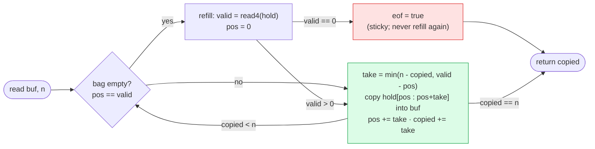

## The question

You are given `read4(buf4)`. Each call copies the next four characters of a file into `buf4` and returns how many it copied: four most of the time, fewer at the end, zero once the file is finished. It has its own file pointer. You cannot touch the file any other way.

Write `read(buf, n)`. It copies up to `n` characters of the file into `buf` and returns how many it copied.

There are two versions. In [LeetCode 157](https://leetcode.com/problems/read-n-characters-given-read4/) `read` is called once. In [LeetCode 158](https://leetcode.com/problems/read-n-characters-given-read4-ii-call-multiple-times/) `read` is called many times, and each call must continue where the previous one stopped. The file is `"abc"`, the calls are `read(1)`, `read(2)`, `read(1)`, and the answers must be `"a"`, `"bc"`, nothing. Version two is the one that gets asked, often with 4096 instead of 4 and bytes instead of characters.

## Explain it to a ten-year-old

A shop sells juice only in packs of four. You want two bottles. You buy a pack, take two, and put the other two in a bag. Tomorrow you want three bottles. You take the two from the bag first, then buy another pack, take one, and put three in the bag. The bag is the whole trick. You never throw it away, and you always empty the bag before you buy a new pack.

The single-call version does not need the bag, because there is no tomorrow. The multi-call version is nothing but the bag.

<div class="r4" aria-label="Animation: the file abcdefg is read four characters at a time into a holding buffer; three calls read(2), read(3), read(5) are served from the holding buffer first and refilled only when it is drained; the last read4 returns zero and sets EOF">
  <div class="r4-grid">
    <div class="r4-lbl">file</div>
    <div class="r4-row r4-file">
      <span>a</span><span>b</span><span>c</span><span>d</span><span>e</span><span>f</span><span>g</span><span class="r4-end">∅</span>
      <div class="r4-chunk"></div>
    </div>
    <div class="r4-lbl">hold</div>
    <div class="r4-row r4-hold">
      <div class="r4-slot"><span class="r4-h0a">a</span><span class="r4-h0b">e</span></div>
      <div class="r4-slot"><span class="r4-h1a">b</span><span class="r4-h1b">f</span></div>
      <div class="r4-slot"><span class="r4-h2a">c</span><span class="r4-h2b">g</span></div>
      <div class="r4-slot"><span class="r4-h3a">d</span></div>
      <div class="r4-pos">▲ pos</div>
      <div class="r4-valid">valid ▼</div>
    </div>
    <div class="r4-lbl">buf</div>
    <div class="r4-row r4-out">
      <span class="r4-o0">a</span><span class="r4-o1">b</span><span class="r4-o2">c</span><span class="r4-o3">d</span><span class="r4-o4">e</span><span class="r4-o5">f</span><span class="r4-o6">g</span>
    </div>
  </div>
  <div class="r4-steps">
    <span class="r4-s0">read(2) · hold empty · read4 → abcd · valid 4, pos 0</span><span class="r4-s1">take 2 → ab · pos 2 · return 2</span><span class="r4-s2">read(3) · serve cd from hold first · pos 4 = valid, drained</span><span class="r4-s3">need 1 more · read4 → efg · valid 3, pos 0</span><span class="r4-s4">take e · pos 1 · return 3</span><span class="r4-s5">read(5) · fg from hold · read4 → 0 · eof · return 2</span>
  </div>
</div>
<style>
.r4 { --cell: 2.9rem; --gap: 0.4rem; --step: calc(var(--cell) + var(--gap)); --t: 12s; margin: 1.25rem 0 1.75rem; font-family: ui-monospace, SFMono-Regular, Menlo, monospace; }
.r4-grid { display: grid; grid-template-columns: 3.2rem auto; gap: 2.1rem 0.8rem; align-items: center; width: max-content; max-width: 100%; }
.r4-lbl { font-size: 0.85rem; opacity: 0.7; text-align: right; }
.r4-row { position: relative; display: flex; gap: var(--gap); width: max-content; }
.r4-row > span, .r4-slot { width: var(--cell); height: var(--cell); display: grid; place-items: center; border: 1px solid #94a3b8; border-radius: 0.35rem; font-size: 1.35rem; }
.r4-file > .r4-end { border-style: dashed; opacity: 0.6; font-size: 1.1rem; }
.r4-chunk { position: absolute; top: -0.25rem; left: -0.25rem; width: calc(4 * var(--cell) + 3 * var(--gap) + 0.5rem); height: calc(var(--cell) + 0.5rem); border: 3px solid #2563eb; border-radius: 0.5rem; background: rgba(191, 219, 254, 0.35); animation: r4-chunk var(--t) steps(1, end) infinite; }
.r4-slot { position: relative; }
.r4-slot > span { position: absolute; inset: 0; display: grid; place-items: center; border-radius: 0.3rem; opacity: 0; animation-duration: var(--t); animation-timing-function: steps(1, end); animation-iteration-count: infinite; }
.r4-h0a { animation-name: r4-ab; } .r4-h1a { animation-name: r4-ab; } .r4-h2a { animation-name: r4-cd; } .r4-h3a { animation-name: r4-cd; }
.r4-h0b { animation-name: r4-e; } .r4-h1b { animation-name: r4-fg; } .r4-h2b { animation-name: r4-fg; }
.r4-pos, .r4-valid { position: absolute; left: 0; font-size: 0.75rem; color: #ea580c; font-weight: 700; width: var(--cell); text-align: left; margin-left: -0.35rem; animation-duration: var(--t); animation-timing-function: steps(1, end); animation-iteration-count: infinite; }
.r4-pos { top: calc(var(--cell) + 0.15rem); animation-name: r4-pos; }
.r4-valid { top: -1.15rem; animation-name: r4-valid; color: #2563eb; }
.r4-out > span { opacity: 0.25; animation-duration: var(--t); animation-timing-function: steps(1, end); animation-iteration-count: infinite; }
.r4-o0, .r4-o1 { animation-name: r4-on1; } .r4-o2, .r4-o3 { animation-name: r4-on2; } .r4-o4 { animation-name: r4-on4; } .r4-o5, .r4-o6 { animation-name: r4-on5; }
.r4-steps { display: flex; flex-wrap: wrap; gap: 0.4rem 1.25rem; margin-top: 1.1rem; font-size: 1rem; }
.r4-steps > span { opacity: 0.35; animation: r4-step var(--t) steps(1, end) infinite; }
.r4-steps .r4-s0 { animation-delay: 0s; } .r4-steps .r4-s1 { animation-delay: -10s; } .r4-steps .r4-s2 { animation-delay: -8s; } .r4-steps .r4-s3 { animation-delay: -6s; } .r4-steps .r4-s4 { animation-delay: -4s; } .r4-steps .r4-s5 { animation-delay: -2s; }
@keyframes r4-chunk { 0%, 49.99% { transform: translateX(0); width: calc(4 * var(--cell) + 3 * var(--gap) + 0.5rem); } 50%, 83.32% { transform: translateX(calc(4 * var(--step))); width: calc(4 * var(--cell) + 3 * var(--gap) + 0.5rem); } 83.33%, 100% { transform: translateX(calc(7 * var(--step))); width: calc(var(--cell) + 0.5rem); } }
@keyframes r4-ab { 0%, 16.65% { opacity: 1; background: #fed7aa; } 16.66%, 49.99% { opacity: 0.35; background: #e2e8f0; } 50%, 100% { opacity: 0; } }
@keyframes r4-cd { 0%, 33.32% { opacity: 1; background: #fed7aa; } 33.33%, 49.99% { opacity: 0.35; background: #e2e8f0; } 50%, 100% { opacity: 0; } }
@keyframes r4-e  { 0%, 49.99% { opacity: 0; } 50%, 66.65% { opacity: 1; background: #fed7aa; } 66.66%, 100% { opacity: 0.35; background: #e2e8f0; } }
@keyframes r4-fg { 0%, 49.99% { opacity: 0; } 50%, 83.32% { opacity: 1; background: #fed7aa; } 83.33%, 100% { opacity: 0.35; background: #e2e8f0; } }
@keyframes r4-pos { 0%, 16.65% { transform: translateX(0); } 16.66%, 33.32% { transform: translateX(calc(2 * var(--step))); } 33.33%, 49.99% { transform: translateX(calc(4 * var(--step))); } 50%, 66.65% { transform: translateX(0); } 66.66%, 83.32% { transform: translateX(var(--step)); } 83.33%, 100% { transform: translateX(calc(3 * var(--step))); } }
@keyframes r4-valid { 0%, 49.99% { transform: translateX(calc(4 * var(--step))); } 50%, 100% { transform: translateX(calc(3 * var(--step))); } }
@keyframes r4-on1 { 0%, 16.65% { opacity: 0.25; } 16.66%, 100% { opacity: 1; background: #dcfce7; } }
@keyframes r4-on2 { 0%, 33.32% { opacity: 0.25; } 33.33%, 100% { opacity: 1; background: #dcfce7; } }
@keyframes r4-on4 { 0%, 66.65% { opacity: 0.25; } 66.66%, 100% { opacity: 1; background: #dcfce7; } }
@keyframes r4-on5 { 0%, 83.32% { opacity: 0.25; } 83.33%, 100% { opacity: 1; background: #dcfce7; } }
@keyframes r4-step { 0%, 16.65% { opacity: 1; font-weight: 700; color: #ea580c; } 16.66%, 100% { opacity: 0.35; font-weight: 400; color: inherit; } }
@media (prefers-reduced-motion: reduce) {
  .r4-chunk, .r4-slot > span, .r4-pos, .r4-valid, .r4-out > span, .r4-steps > span { animation: none; }
  .r4-chunk { transform: translateX(calc(7 * var(--step))); width: calc(var(--cell) + 0.5rem); }
  .r4-h0b, .r4-h1b, .r4-h2b { opacity: 0.35; background: #e2e8f0; }
  .r4-pos { transform: translateX(calc(3 * var(--step))); } .r4-valid { transform: translateX(calc(3 * var(--step))); }
  .r4-out > span { opacity: 1; background: #dcfce7; }
  .r4-steps .r4-s5 { opacity: 1; font-weight: 700; color: #ea580c; }
}
</style>

Watch the second call. It takes `c` and `d` out of the holding buffer before it asks `read4` for anything. Then watch the last call. It gets `f` and `g`, asks `read4` once more, gets zero, and remembers that forever.

## The trick

Keep one holding buffer the size of a `read4` chunk, and two indices into it. `pos` is the next character you have not yet handed out. `valid` is how many characters in the buffer are real. The slice `hold[pos:valid]` is the bag of leftovers. Then one invariant, which you should write as a comment before you write any code:

> Every character `read4` has ever returned is either already delivered to a caller or still sitting in `hold[pos:valid]`. Nothing is skipped and nothing is handed out twice.

Each call to `read` is a loop with four branches. If the bag is empty and we have not seen the end, refill it. If the refill returned zero, remember end-of-file and stop. Otherwise take as much as the caller still wants or as much as the bag holds, whichever is smaller, copy it, and move both counters. That is the whole algorithm. There is no cleverer one: every character must be copied into the caller's buffer at least once, so the work is linear in characters delivered, and one chunk of extra memory is enough because you only refill when the bag is empty.



The state has to live on the object, not in the function. If `hold`, `pos` and `valid` are locals, every call starts with an empty bag and the leftovers from the last `read4` are gone. That is not a style choice. It is the bug the question exists to catch.

## The steps

First the single-call version, because it shows why the multi-call version needs state. Called once, you never have leftovers to keep, so you can read straight into the caller's buffer in chunks of four and stop when the caller is satisfied or `read4` runs dry.

```python
class Solution157:
    def read(self, buf, n):
        buf4, copied = [""] * 4, 0
        while copied < n:
            k = read4(buf4)
            if k == 0:
                break
            take = min(k, n - copied)
            buf[copied:copied + take] = buf4[:take]
            copied += take
        return copied
```

There is a small lie in it. If `read4` returned four and the caller only wanted two, the other two are lost. For one call that is fine. For the second call it is the whole problem, so now the bag moves to the object.

1. On construction: `hold = [""] * 4`, `pos = 0`, `valid = 0`, `eof = False`.
2. On `read(buf, n)`: set `copied = 0` and loop while `copied < n`.
3. If `pos == valid`, the bag is empty. If `eof`, stop. Otherwise `valid = read4(hold)`, `pos = 0`. If `valid == 0`, set `eof` and stop.
4. `take = min(n - copied, valid - pos)`. Copy that slice from `hold` into `buf` at `copied`. Add `take` to both `pos` and `copied`.
5. Return `copied`. Zero means the caller has reached the end.

```python
class Solution:
    def __init__(self):
        self.hold = [""] * 4   # one chunk of leftovers
        self.pos = 0           # next character not yet handed out
        self.valid = 0         # how many characters in hold are real
        self.eof = False       # sticky once read4 returns 0

    def read(self, buf, n):
        # hold[pos:valid]: received from read4, not yet delivered
        copied = 0
        while copied < n:
            if self.pos == self.valid:       # bag empty: refill
                if self.eof:
                    break
                self.valid = read4(self.hold)
                self.pos = 0
                if self.valid == 0:          # 0 is the end, a short read is not
                    self.eof = True
                    break
            take = min(n - copied, self.valid - self.pos)
            buf[copied:copied + take] = self.hold[self.pos:self.pos + take]
            self.pos += take
            copied += take
        return copied
```

Walk it with numbers before you say you are done. File `"abcdefg"`, calls 2, 3, 5. Call one: bag empty, refill gives `abcd`, `valid` 4, take 2, `pos` 2, return 2. Call two: `pos` 2 is not `valid` 4, so take `min(3, 2)` which is 2, now `pos` 4 and the bag is empty. Refill gives `efg`, `valid` 3, take `min(1, 3)` which is 1, `pos` 1, return 3. Call three: take `min(5, 2)` which is 2, bag empty, refill returns 0, `eof` is set, return 2. The next call of any size returns 0 without touching `read4`.

Time is linear in the characters delivered, which is the lower bound. Extra space is one chunk, so constant.

## The template

This shape is the buffered reader. Every language ships one: `io.BufferedReader` in Python, `BufferedReader` in Java, `bufio.Reader` in Go. In an interview you write it from memory. The parts that change are in capitals.

```python
class BufferedReader:
    def __init__(self, FILL):
        self.fill = FILL              # the fixed-chunk primitive given to you
        self.hold = bytearray(CHUNK)  # CHUNK: the primitive's maximum
        self.pos = self.valid = 0
        self.eof = False

    def read(self, buf, n):
        n = min(n, len(buf))          # never write past the caller's buffer
        copied = 0
        while copied < n:
            if self.pos == self.valid:
                if self.eof:
                    break
                self.valid = self.fill(self.hold)
                self.pos = 0
                if IS_END(self.valid):   # usually valid == 0
                    self.eof = True
                    break
            take = min(n - copied, self.valid - self.pos)
            COPY(buf, copied, self.hold, self.pos, take)
            self.pos += take
            copied += take
        return copied
```

What changes per problem: the chunk size (4, 4096, a network frame), what the end looks like (zero, a negative number, an `io.EOF` error returned alongside the last bytes in Go), and how you copy (a slice, `System.arraycopy`, `memcpy`). What must be understood, not memorised: why the refill happens only when `pos == valid`, why the end flag is sticky, and why a short read is not the end. Once you see that every stream adapter is this loop, the question stops being about `read4` and starts being about whether you keep your state where it survives the call.

## The board



[Download the one-page cheat sheet](/teach/coding/read4-cheat-sheet.pdf) (A4, two sides: front is what to ask, what to write and in what order for a 45-minute coding round, back is this board).

## In GPU infrastructure

Every health check I run on a GPU host ends up reading a stream through a fixed-size hole. The burn-in orchestrator pulls each node's test log back in fixed frames, and the parser wants one line at a time, so under the parser sits exactly this class with a newline scan on top: hold the frame, serve up to the newline, keep the rest for the next call. An RDMA completion queue is the same shape one level down, where the NIC fills fixed-size descriptors and the application wants messages of whatever size the sender chose. The bug in this lesson is the bug that drops the tail of every frame, which in a log tailer means one line in every sixty-four kilobytes silently missing from the summary that decides whether a node goes back into the fleet.

## What I am listening for

- Do you ask whether `read` is called more than once before you write anything. That one question decides whether you need an object.
- Do you ask what zero means and whether a short read means the end. Then do you check the zero before you do arithmetic with it.
- Do you put `hold`, `pos` and `valid` on the object the first time I say "class" or "member variables". A hint from me is the answer key, not a style note.
- Do you write the copy as a slice, or at least name a `copy(dst, off, src, off, n)` helper and define it after. A single indexed assignment for a range is a bug, not a shortcut.
- Do you write the test list before the code and walk two of them with real numbers: empty file, a request smaller than the chunk, a request larger than the chunk, a file that is exactly one chunk long.
- If I ask about threads: one lock around the body of `read`. The helper runs under it, so its file pointer is safe too. Readers serialise, which is fine, because the stream is sequential anyway.

## What I got wrong in the mock

A Google engineer gave me this question in a mock with 4096 instead of 4 and bytes instead of characters. I had the right algorithm by minute sixteen: one holding buffer, `pos` and `valid`, refill only when drained, the invariant said out loud. The code was never correct for a second call. Five defects, in the order a reviewer hits them:

| # | What I wrote | Effect | Fix |
|---|---|---|---|
| 1 | `pos`, `valid` and the holding buffer created inside `read` | Leftovers lost on every call after the first, which is the question | Member variables on a class |
| 2 | No check of the helper's return for zero | At the end, `take` is 0 and `while copied < n` never exits | `if valid == 0: eof = True; break` |
| 3 | `out[copied + take] = tmp[pos + take]` | One byte, at the wrong index, into a name that did not exist | A slice: `buf[copied:copied+take] = hold[pos:pos+take]` |
| 4 | Holding buffer sized from the caller's buffer, re-created per call | Wrong size and no memory between calls | One `bytearray(CHUNK)` in the constructor |
| 5 | `n` never capped by `len(buf)` | Writes past the caller's buffer when they disagree | `n = min(n, len(buf))` |

The interviewer said "class" and "member variables" twice. I heard a style preference. It was the answer. I also spent five minutes looking for something better than the first idea, calling it brute force, when the first idea already met the lower bound. Those five minutes were the five minutes the second-call bug needed. And I reached for systems words that were not true: a loop does not blow the stack, and there is no watchdog in a buffered reader. One wrong systems claim costs more than three right ones earn.

What I do now on every stateful coding question: ask single or multi thread, ask user space or kernel, ask what the sentinel means, take the structural hint the first time, write the tests before the code, and close with a status rather than an apology. "Works for the seven cases, thread-safe with one lock, the one thing I would still test is a helper that returns short reads forever."


- **The bag of leftovers lives on the object.** `hold`, `pos`, `valid`, `eof`. Locals lose it.
- **Serve the bag first, refill only when `pos == valid`.** One chunk of memory is enough.
- **Check for zero before the arithmetic.** Zero is the end and it is sticky. A short read is not the end.
- **Copy a slice, cap `n` by the buffer, test the empty file.** Then walk two cases with numbers.


## Go deeper

- [LeetCode 157](https://leetcode.com/problems/read-n-characters-given-read4/) is the single call. Do it first, then notice what it throws away. [LeetCode 158](https://leetcode.com/problems/read-n-characters-given-read4-ii-call-multiple-times/) is the one that gets asked.
- Python's [`io.BufferedReader`](https://docs.python.org/3/library/io.html#io.BufferedReader) and Go's [`bufio.Reader`](https://pkg.go.dev/bufio#Reader) are this class with a bigger chunk. Read `bufio.Reader.Read` once; it also skips the holding buffer for large reads, which is the zero-copy follow-up.
- Variants to drill: `read_line()` on top of `read` (scan the bag for a newline, keep the rest); a helper that can raise a transient error (retry without losing position, because state only changes after a successful return); the same in Go, where `Read` can return bytes and `io.EOF` in the same call, which changes the end check.
- [Min Stack](/teach/coding/min-stack/) is the other coding question that is really a design question: pay a little memory on every call to make the next call cheap.

**With AI on the table.** The tool writes the class correctly on the first try. I ask it to remove the end-of-file flag and tell me which test now loops forever. Then I ask it to make `read` thread-safe and explain what the lock protects, and whether the helper's file pointer is covered. Then I ask what happens if the helper returns short reads forever. If you can answer those three without running it, you understood the loop.
