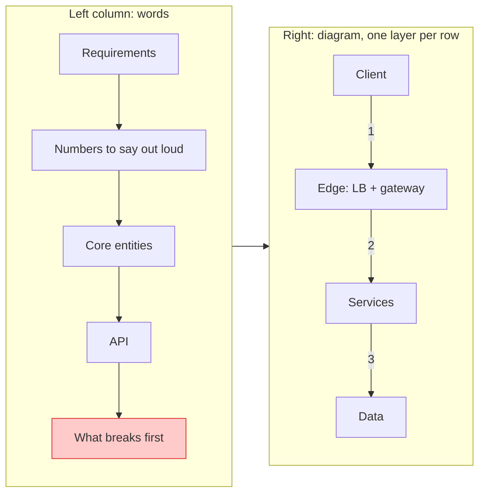

## The question

You have 45 minutes and a blank canvas. It might be Excalidraw, a Google Doc, or a bare text editor. How do you draw the design so the person across the table can follow every step, and so the board still makes sense at minute 40?

## Explain it to a ten-year-old

Think of a map of your town. The houses are at the top, the main road is in the middle, the shops are below it and the warehouse is at the bottom. The bus route is a thick line with numbered stops. The side streets are dotted. There is a little key in the corner saying what the colours mean. And there is a red sign on the bridge that floods first. A good design board is that map.

## The trick

Draw the board you will end with, empty, before the question starts. The left column headings, four layer rows, a legend. Then every step of the [45-minute plan](/teach/system-design-in-a-hurry/) fills a slot that is already there. You grow one board. You never wipe it and redraw.

## The steps

1. **Requirements on the left, five minutes.** Three "a user can..." lines and three qualities with numbers. Write them down. Do not just say them.
2. **Numbers to say out loud.** Four or five: users, requests per second, read to write ratio, storage. For the URL shortener that is 100M daily users, about 6k redirects a second, a thousand reads per write, half a terabyte.
3. **Entities and API under that, seven minutes.** A short list and two or three endpoints.
4. **Diagram on the right, one layer per row.** Client, edge, services, data, top to bottom. Label each box with the real tech: "Cache (Redis)", not "Cache".
5. **Numbered solid arrows for the main path.** 1, 2, 3 in the order a request travels. Dashed for responses, control and failure. No crossings: move a box instead.
6. **Legend and the red note.** Three or four colours with a key. One red sentence by the box that fails first.
7. **Deep dives grow the board.** Add a box, a dashed path, a note. Keep it on the same canvas.

## The board



This is the [URL shortener](/teach/systems/design-a-url-shortener/) board, and every lesson on this page uses the same layout. The full tutorial for Excalidraw, Google Docs with a Drawing, and ASCII, with the same design drawn all three ways, is in [How to Draw System Design Diagrams in Interviews](/posts/system-design-diagrams-for-interviews/).

## What I am listening for

- Whether your requirements are written down before the first box appears.
- Whether I can follow the request by reading the arrow numbers, without you pointing.
- Whether boxes name real technology, so I know what to ask about.
- Whether you grow the board or start over. Starting over at minute 25 almost always runs out of time.
- Whether you already know the tool. Ask the recruiter which one they use, and practise it.


- **Words left, diagram right.** Requirements, numbers, entities, API, what breaks first.
- **One layer per row.** Client, edge, services, data.
- **Solid numbered arrows** for the main path, **dashed** for everything else, **no crossings**.
- **Legend, red note, numbers block.** Every board.
- **Grow it, do not redraw it.** Keep a template ready in the company's tool.


## Go deeper

- [Excalidraw](https://excalidraw.com) is free and needs no account. Press `?` inside it for the full shortcut list.
- [Google Docs drawings help](https://support.google.com/docs/answer/179740) covers Insert > Drawing > New, shapes and connector lines.
- [Hello Interview's delivery guide](https://www.hellointerview.com/learn/system-design/in-a-hurry/delivery) walks through the same order: requirements, entities, API, data flow, high level, deep dives.
- [ASCIIFlow](https://asciiflow.com) is a good place to practise ASCII boxes before a round in a bare editor.

**With AI on the table.** An assistant will happily generate a polished diagram in seconds. That is not what the round is testing. I want to watch you build the board one layer at a time and explain each arrow as you add it. If you paste a finished picture, I will ask you to walk me through arrow 3, and then what happens when the red box fails.
